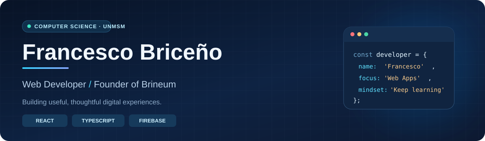

 

**Estudiante de Ciencias de la Computación en la Universidad Nacional Mayor de San Marcos (UNMSM)**  
**Desarrollador web · Fundador de Brineum · Lima, Perú 🇵🇪**

*Me gusta convertir problemas reales en soluciones digitales claras, funcionales y accesibles.*

---

### 👨‍💻 Sobre mí

Soy **Francesco Briceño**, estudiante de **Ciencias de la Computación en la UNMSM**. Me interesa la ingeniería de software y el desarrollo de productos digitales que combinen una buena experiencia de usuario con soluciones técnicas sólidas.

- 🎓 Me formo en Ciencias de la Computación en la **Universidad Nacional Mayor de San Marcos**.
- 🚀 Soy fundador de **[Brineum](https://brinew-proyect.web.app/)**, mi iniciativa de desarrollo web.
- 🧩 Disfruto diseñar interfaces, resolver problemas y construir aplicaciones completas.
- 🌱 Continúo aprendiendo sobre arquitectura de software, desarrollo web y buenas prácticas.

### 🛠️ Tecnologías y herramientas

**Lenguajes y estilos**

**Frontend**

**Servicios y herramientas**

### 🚀 Proyectos seleccionados

| Proyecto | ¿Qué hace? | Enlace |
| :-- | :-- | :--: |
| 📚 **Studytime** | Plataforma de apoyo académico con cursos y recursos educativos. | [Ver web ↗](https://studytime-b006e.web.app/) |
| ⚽ **FISITORNEOS** | Gestión de torneos deportivos, equipos, partidos y resultados. | [Ver web ↗](https://torneos-fisi.web.app/panel) |
| 🎟️ **App CTU** | Sistema digital de tickets y gestión de turnos estudiantiles. | [Ver web ↗](https://app-ctu.web.app/) |
| 🌐 **Brineum** | Mi marca de desarrollo de páginas web y soluciones digitales. | [Ver web ↗](https://brinew-proyect.web.app/) |

> Algunos proyectos forman parte de trabajos realizados para terceros. Los enlaces muestran sus versiones web; el código fuente se comparte únicamente cuando corresponde.

### 🎯 En qué estoy enfocado

- Fortalecer mis conocimientos de **Ciencias de la Computación** y fundamentos de programación.
- Mejorar la calidad, mantenibilidad y experiencia de usuario de mis aplicaciones.
- Seguir construyendo proyectos útiles y desarrollar **Brineum** con una identidad profesional.

---

**¿Tienes una idea o proyecto web?**  
[Visita mi portafolio](https://brinew-proyect.web.app/#contacto) · [Escríbeme](mailto:franchis16bm@gmail.com)

Hecho con dedicación por Francesco Briceño · Perú 🇵🇪

